# 从一个按钮开始：AI 交互落地实践与架构演进

> 偶然在小荷 AI 医生里看到一段没被渲染的原始标签，让我想起第一次在云睿做 AI 交互落地时的情景。当时我们为了在回答末尾塞个跳转按钮，硬生生把一个工具文件写到了 841 行。后来我带着这些痛点写了两个实验 Demo，又去研究了市面上的 AI SDK、AG-UI、A2UI 等各种新方案。这篇文章不是为了吹捧哪种技术最高级，而是想跟大伙儿聊聊：**一个看似简单的“正文里长个按钮”的需求，究竟是怎么把我们一步步逼向架构深水区的？**
>
> *注：文中“云睿”是我们自己的业务项目；Spring Boot 与 NestJS 纯属为了验证想法搭的实验工程。配网示例中的 F001 仅作代号。至于小荷和瑞幸，纯粹是站在用户视角看它们的界面表现，不涉及对别人内部代码或底层协议的任何揣测。*

---

## 引子：AI 界面里露出的“马脚”

前几天用小荷 AI 医生，聊到一半它本该继续追问我的情况，界面上却突兀地蹦出这么一段没被前端吃掉的原始文本：

```text
<ask_user_question>
false
["清的/透明的", "白色黏稠的", "黄色或黄绿色的", "带点血丝/痂皮"]
你早上那坨鼻涕/黏液大概是什么颜色和质地呢?
鼻涕性状
</ask_user_question>
```

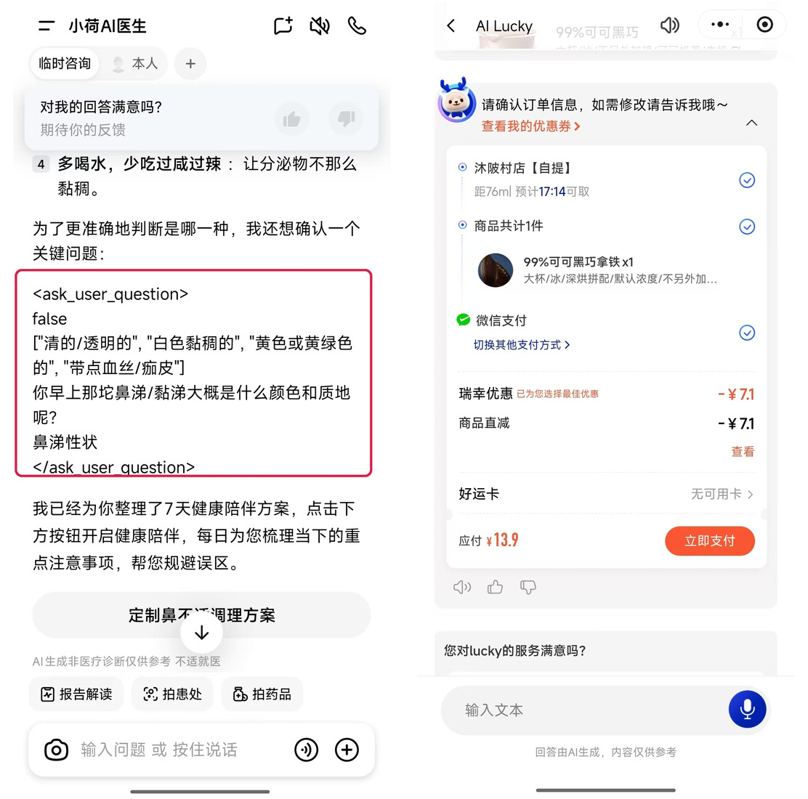

盯着这堆标签看了半天，不是觉得新鲜，而是太亲切了——**我们在公司的云睿项目里，当年走的不就是这条路吗？**

让大模型在吐文字的同时，顺便在正文里夹带私货（比如输出一段约定好的标签），前端再用正则去文本里把参数抠出来，转成页面上的按钮或者卡片。

我无法确认小荷内部是不是这套实现，但这种“在自然语言流里藏结构化指令”的骚操作，实在是太接地气、也太容易让人踩坑了。看到这个现象，我不禁琢磨：**这是我们当初代码写得不够优雅，还是这条技术路线本来就藏着死胡同？现在大家口中那些高大上的 AI 应用，又是怎么擦屁股的？**

带着这肚子疑问，我折腾了两个 Demo，顺便把这篇总结给盘了出来。

---

## 一、回到业务：为什么聊天框装不下我们的野心

云睿里有个场景是配网规划知识问答。规划这活儿可杂了，什么馈线负载、重过载、N-1 校验、投资估算全卷在一起。用户问个问题，往往不是要看一段干巴巴的解释，而是需要一套“查数据、看分析、给方案、出报告”的组合拳。

比如用户丢过来一句：

> 帮我分析 F001 馈线的重过载情况，给出改造建议，并生成报告。

如果 AI 只是冷冰冰地回一句：“F001 有重过载风险，建议改造”，那用户看完还得自己退出聊天界面，去菜单里翻规划模块、重新选馈线、再去找报告文件。

我们当时就觉得，一个合格的 AI 交互得有三种本事：

1. **能读**：结论、表格、公式直接在对话里看爽。
2. **能操作**：一眼能看到业务入口，一键就能带着当前的筛选条件跳转到对应页面。
3. **能产出**：报告跑完后，直接在消息流里甩出文件下载链接。

说白了：**聊天框只是个引子，用户真正要干的是业务活。**

于是问题甩到了前端：大模型给的是一坨流式文本，用户要的是正文、按钮、卡片和能点开的动作。这两头怎么对接？

---

## 二、第一次落地：简单粗暴，把协议直接塞进正文

当时最直观的解法就是搞“文本夹带”。既然提示词能约束模型输出格式，那我们就跟模型约定：正常说话行，但遇到要跳转时，顺手吐个标签：

```xml
F001 馈线的重过载分析已经完成，可以进入详情页查看。

<route>
{
  "routePath": "/planning/overload",
  "buttonText": "查看分析",
  "filter": {
    "type": "json",
    "content": { "feederId": "F001" }
  }
}
</route>
```

*（注：这里的路径是示意，不是云睿真实代码。字段参考了我们当时写的 `parseRouteFromAnswer()`、`normalizeRouteFilter()` 和 `flattenJsonFilterToQuery()`。另一个主要标签是 `<report_content>`，用于提取报告文件名称和下载地址。）*

前端接 SSE（Server-Sent Events）的时候，一边渲染 Markdown，一边拿正则去洗这堆标签。抽出来了，就在界面上长个按钮或报告入口。

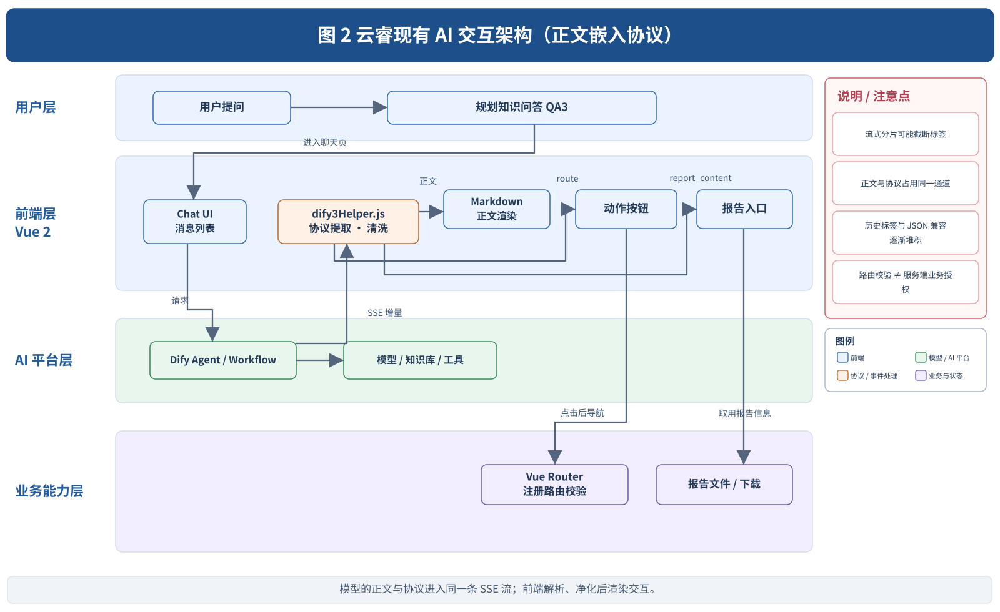

在当时的代码库里，这套逻辑主要散落在：

- `PlanningKnowledgeQa3/index.vue`、`MessageList.vue`（各种问答视图）；
- `DifyChatService.js`（搞流式、会话、重试、跳转动作等业务流程）；
- `dify3Helper.js`（洗文本、剥离思考标签、解 JSON、拼兼容）；
- `routeUtils.js`（防呆校验，看看路由有没有注册过，别瞎跳）。

这套方案的优点非常明显：**快。** 不需要为了加个按钮去推翻重构整套消息中心；对大模型的要求也低，只要它听话、肯按格式吐文本就行。依托已有的 Vue 2 老页面和 Dify，几天时间功能就跑通了。

但“顺手接一个需求”和“让这套架构长期可维护”完全是两码事。后来回过头看，把“UI 交互解析”和“纯文本渲染”搅和在一块儿，正是我们日后痛苦的根源。

### 一个 `route` 标签背后的泥潭

别看代码里写了个 `routePath`，它其实并不是后端统一签发的安全路由，而是前端拿去跟 Vue Router 的注册表比对，再把参数拼进去。这顶多算个防错，离严格的权限校验还差得远。

更头疼的是，随着业务变多，标签开始失控。项目里除了 `<route>`，还陆续冒出过 `<report_content>`、`<circuits>`、`<sql_route>`、`<tp_route>`、`<dify_thinking>`、`<think>`、`<end_time>` 等历史遗留标签。模型一高兴，或者提示词稍微飘一点，标签的嵌套和格式就全乱了。

---

## 三、从一个小标签，到长达 841 行的“擦屁股”代码

“841 行”不是修辞，压缩包里 `src/utils/dify3Helper.js` 的真实体量就摆在那里。

当然，这 841 行不全是正则，里面还揉了思考文本（Thinking）清理、推荐追问解析、时间戳格式化、JSON 容错等一堆杂物。但它结结实实地说明了一件事：**当你想在文本里搞“富交互”时，你以为你在写业务，其实你大半的时间都在跟大模型的“不确定性”肉搏。**

来看看我们踩过的几个深坑：

1. **SSE 分片不认标签**：大模型吐字是一块一块的，第一帧可能只来个 `<rou`，第二帧才补全 `te>`。如果前端拿到碎块就急着丢进 Markdown 解析，用户就会看到页面上的半截标签一闪而过、甚至把排版冲烂。为此，助手不得不写了 `stripTrailingPartialProtocolTag()` 去判断“这到底是个不完整的标签前缀，还是用户正常打的‘小于号’”。
2. **残缺的 JSON 无法直接落地**：模型吐到一半断流了，或者 JSON 还没闭合：`<route>{"routePath":"/planning/overload"`。为了不让页面报错，我们引入了 `jsonrepair`。但哪怕修好了，你也**绝对不能**在流式传输还没结束时，就急吼吼地把按钮渲染出来——万一参数没吐完呢？所以项目在 `parseAnswerBlocks(answer, { streaming: true })` 里卡了一条死线：流式阶段只认闭合协议。
3. **一条回答里夹着好几组正文+动作**：如果模型一口气分析了三张表，吐出了三个交替的文本和 `<route>`，前端如果用粗暴的 `indexOf` 或贪婪正则去截取，后面的动作直接就人间蒸发了。必须按块提取，死守 `正文 A → route A → 正文 B → route B` 的原始顺序。
4. **格式飘忽与历史包袱**：模型有时会把标签包进 Markdown 代码围栏里，正文里用户也可能真的在问“`<route>` 是什么意思”。再加上早期的老会话里还存着各种废弃的标记，为了保证历史消息不崩，这些“祖传代码”只能一层一层往上套 `try-catch` 和兼容分支。

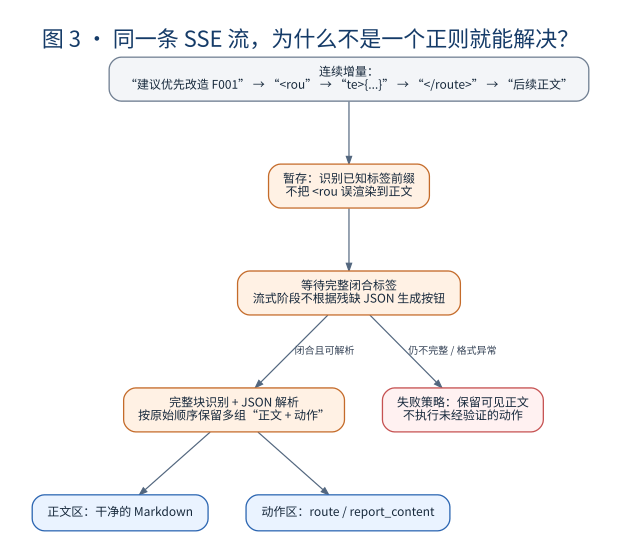

把这些踩坑成本拉张表，一目了然：

| 遇到的情况             | 前端不得不增加的处理   | 背后的问题                               |
| ---------------------- | ---------------------- | ---------------------------------------- |
| 标签被拆成多段         | 已知标签前缀暂存       | 流分片与语法边界无关                     |
| JSON 尚未闭合          | 流式阶段延迟动作解析   | 不完整参数不应触发动作                   |
| 模型把协议包进代码围栏 | 围栏兼容与正文清洗     | 模型并不知道“协议”与“示例代码”的业务区别 |
| 正文中真的出现标签名   | 判断是否属于协议上下文 | 普通文本与控制信息共享通道               |
| 一条回答有多组动作     | 按块处理、保持顺序     | 一个消息不一定只有一个 UI 结果           |
| Prompt 历史格式变化    | 多种字段形态归一化     | 模型输出没有强类型契约                   |
| 老会话仍含废弃标记     | 历史剥离与兼容         | 协议演进会形成长期维护成本               |

说实话，**这事儿真不能怪正则。** 对于封闭且简单的文本协议，正则加状态机完全够用。问题在于，我们把一个“脆弱的文本解析方案”，当成了支撑整套业务交互的骨架。

---

## 四、问题到底出在哪：我们把四类不搭界的活儿揉成了一团

复盘下来，大伙儿之所以痛苦，是因为我们把根本不该搅和在一起的**四种职责**，全都塞进了一条长长的文本流里：

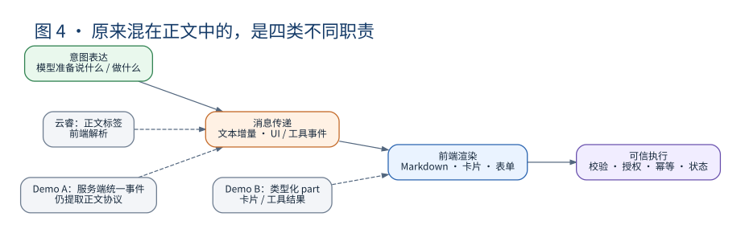

1. **意图表达**：模型究竟想干嘛？是要解释概念、建议跳转，还是想触发系统底层调用？
2. **消息传输**：这些信息怎么传到客户端？是靠一串混杂了控制符的 Markdown，还是带类型的标准事件？
3. **UI 渲染**：前端凭什么数据去画按钮和卡片？组件库里到底有哪些东西是允许被调用的？
4. **可信执行**：用户点了按钮之后，谁来校验他的权限？这笔账、这个状态对不对？

在云睿最初的“正文夹带标签”方案里，前两层全混在文本里了，第三层全靠前端硬解，第四层基本处于裸奔状态。只要业务简单，这还能凑合；一旦想上复杂卡片、多端同步或者写数据库的动作，这套架构分分钟得崩。

---

## 五、市面上的主流方案，其实不是“代际升级”

研究了一圈现在各种高大上的方案（从 AI SDK 到 A2UI、MCP Apps），我发现它们并不是老旧技术的替代品，更像是把上面那四层职责进行了不同的切分：

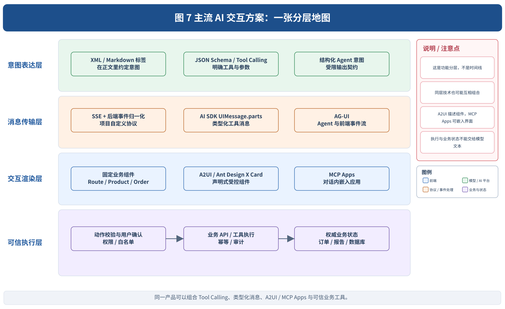

### 5.1 自定义文本协议（Markdown / XML 标签）

门槛最低，改动最小。适合单端、以纯文本回答为主的简单展示。代价就是前端的解析和兼容代码会随着时间推移变成一坨“屎山”。

### 5.2 JSON Schema / Function Calling（工具调用）

让模型明确吐出结构化意图（比如 `{ "tool": "navigate_page", "arguments": { "page": "overload_analysis", "feederId": "F001" } }`），而不是让前端去文本堆里大海捞针。意图和正文终于分家了，但参数校验和权限控制依然得后端兜底。

### 5.3 AI SDK（如 Vercel AI SDK）

在 UI 侧把消息拆成类型化的 `parts`。文本是 `text` part，工具调用是 `tool` part：

```js
message.parts = [
  { type: 'text', text: '为你推荐了几款商品。' },
  {
    type: 'tool-recommend_products',
    state: 'output-available',
    output: { kind: 'product_list', items: [/* ... */] }
  }
]
```

前端根据 `part.type` 和工具生命周期（loading、成功、报错）干净利落地分发给对应组件，告别正则猜标签。不过它解决的是消息表达和渲染接入，具体的业务规则还得自己写。

### 5.4 AG-UI / A2UI / MCP Apps 与应用生态

- **AG-UI**：更侧重 Agent 与前端之间的标准事件通信契约（如运行进度、状态同步、用户中断），常与 CopilotKit 等生态配合。
- **A2UI**：Google 在 2026 年 11 月刚推出 1.0 稳定版 [1]，思路是让 Agent 用结构化数据去描述界面，宿主从受控的可信组件库里组装原生组件，而不是让模型乱吐 HTML/JS。
- **MCP Apps**：路子更野，工具直接声明一个 `ui://` 资源，宿主在对话里开个沙箱化的 iframe 把整个复杂应用嵌进去 [2]，甚至还能跟 A2UI 组合着用 [3]。
- **Ant Design X / CopilotKit**：属于应用层 UI 生态，像 `@ant-design/x-card` 就直接提供了基于 A2UI 思路的动态卡片渲染能力 [4]，省得大家重复造轮子。

把这些主流路线放到一张表里对比下：

| 路线                       | 主要解决什么             | 代价或边界                         | 与本文关系   |
| -------------------------- | ------------------------ | ---------------------------------- | ------------ |
| 文本标签 / Markdown 扩展   | 快速表达少量交互         | 文本混流、解析兼容                 | 云睿实践     |
| JSON Schema / Tool Calling | 结构化表达动作意图       | Schema、参数校验、工具授权         | 结构化转折点 |
| 后端事件归一化             | 统一接入、解析与多端消费 | 中间层复杂度；若上游是文本仍需提取 | Demo A       |
| AI SDK `UIMessage.parts`   | 类型化消息与工具组件     | 组件契约、消息生命周期             | Demo B       |
| AG-UI                      | Agent—前端事件与状态协作 | 需要与具体 UI 实现集成             | 技术研究     |
| A2UI                       | 动态描述并渲染受控组件   | 组件目录、绑定、运行时支持         | 技术研究     |
| MCP Apps                   | 对话中嵌入完整交互界面   | 沙箱、通信桥、宿主兼容             | 技术研究     |

---

## 六、动手实践：我写了两个 Demo 来验证想法

光看文档容易纸上谈兵。为了看看换个架构究竟能省多少心，我动手搞了两个实验性 Demo。

### 实验 A：把文本解析从前端赶回后端

用 Spring Boot + Dify + Vue 2.7 搞了一套。核心思想很简单：**既然前端写正则解析太恶心，那就让后端来干。**

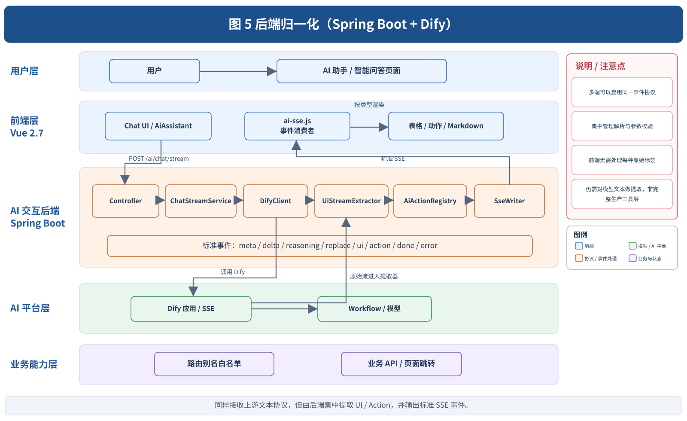

后端接了 Dify 的 SSE，用一个状态机（`UiStreamExtractor.java`）在服务端把文本里的各种 UI 标记、裸 JSON、代码块洗干净，通过括号配平判断完整性，最后把数据切成标准的事件流（`meta`、`delta`、`reasoning`、`replace`、`ui`、`action`、`done`、`error`）吐给前端。同时，后端用 `AiActionRegistry` 维护了一套路由别名白名单，前端不准瞎跳，必须命中白名单。

**体悟**：把解析移到后端，确实解放了前端，让多端（Web、小程序）共用同一套事件流变得容易了许多，但这并没有消灭协议本身，只是把维护的脏活累活从浏览器搬到了服务器。

### 实验 B：拥抱 AI SDK，用类型化消息替代文本标签

换成了 NestJS + `@nestjs/ai` + AI SDK + Vue 3 的组合。覆盖了商品推荐、单选、指标卡、ECharts、Mermaid、订单确认、支付演示和评价等全套交互。

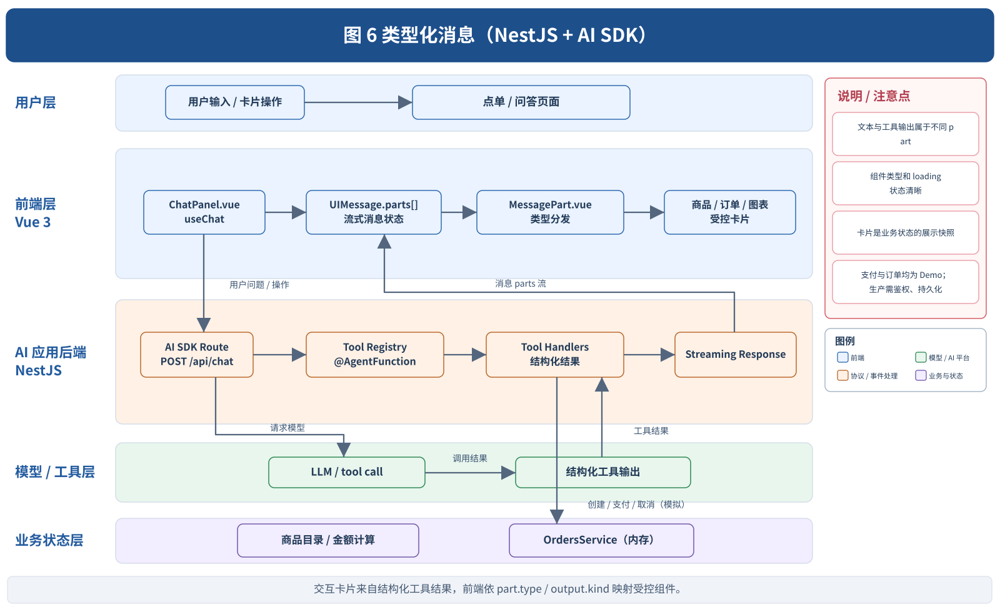

这回彻底不玩“正文夹带私货”了，直接上 Tool Calling 和结构化 `parts`。前端 `MessagePart.vue` 的渲染逻辑清爽了很多：

```ts
if (part.type === 'text') {
  // 走常规 Markdown
} else if (part.type.startsWith('tool-') && part.state === 'output-available') {
  // 稳稳地根据 tool 的 output.kind 渲染专属卡片（如 RouteCard、ProductListCard、OrderCard）
}
```

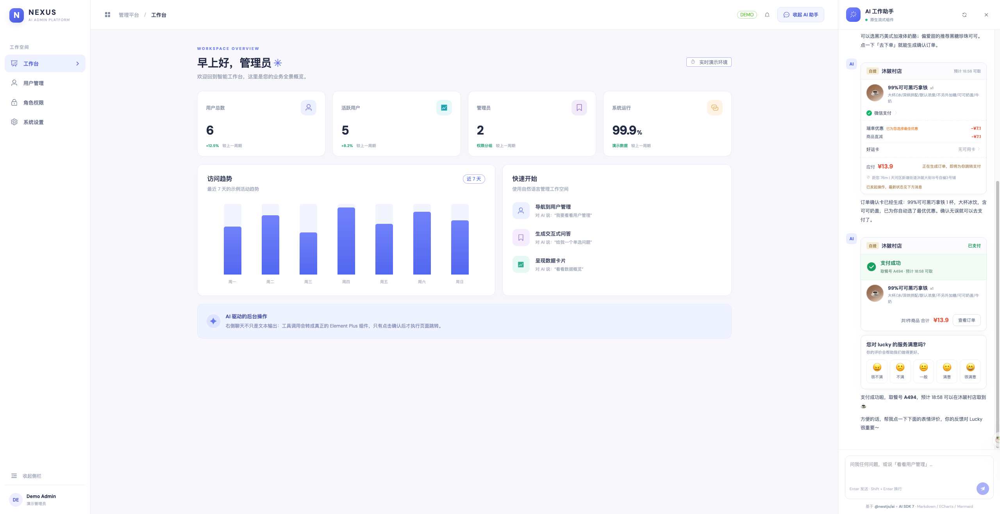

没有了解析残缺标签的焦虑，也没有到处乱飞的正则。用户点完卡片按钮后，可以通过设置 `metadata.hidden` 的隐藏 follow-up 消息把操作悄悄喂给模型，界面上不会冒出尴尬的“我点了按钮”气泡，整个交互连贯得像原生 App。当然，涉及资金或订单修改的动作，生产环境还是得走显式的业务 API 和幂等校验。

| 维度               | 云睿                   | 实验 A：Spring Boot          | 实验 B：AI SDK                      |
| ------------------ | ---------------------- | ---------------------------- | ----------------------------------- |
| 模型表达交互的方式 | 正文标签               | 仍可在正文中带协议           | 结构化工具结果 / 类型化 part        |
| 主要解析责任       | 前端工具层             | 后端提取与归一化层           | SDK 消息层 + 工具契约               |
| 交互展示           | 以正文、跳转、报告为主 | 表格、动作等标准事件         | 多种业务卡片、图表与订单            |
| 新增复杂度         | 兼容历史标签与分片     | 网关、服务端状态机与事件协议 | Tool Schema、消息生命周期与业务状态 |
| 得到的认识         | 能够快速落地           | 可以集中协议知识             | 可以让消息天然包含组件数据          |

---

## 七、从按钮到业务闭环：卡片不该只是个“会动的美术UI”

看了瑞幸等产品的 AI 交互后，我发现它们最厉害的地方不是卡片有多炫，而是**界面能死死咬住业务状态**。

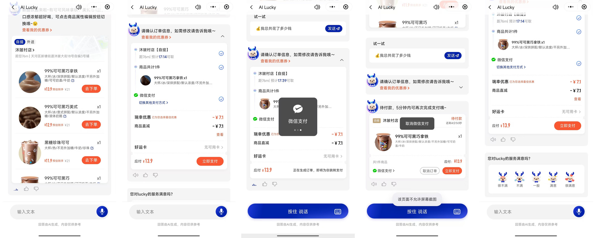

为了搞明白这个，我在实验 B 里顺手撸了个内存订单状态机：服务端管商品、金额和状态，返回 `expiresAt` 给前端算五分钟倒计时，前端根据不同的状态渲染待支付、已取消或已完成的卡片视图。

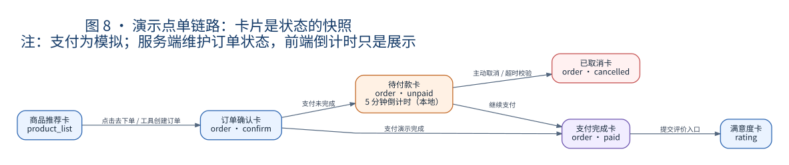

光有状态机图还是抽象的，真实跑起来是这样（下面是录屏，不是拼的截图）：

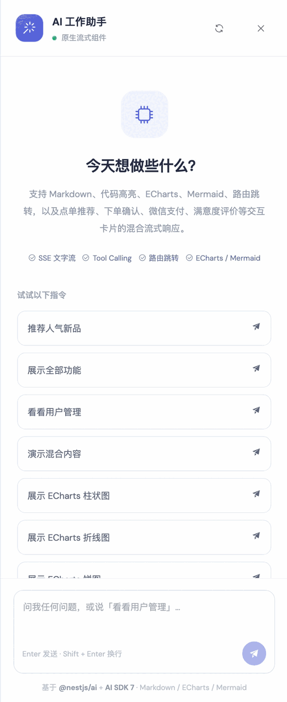

请注意每次点按钮之后发生了什么：服务端重新算一遍状态，再把一张**新卡片**推下来。旧卡片失效、新卡片追加，而不是在同一张卡上把“待支付”改成“已支付”。用户点的那个按钮，本质上只是往对话里补了一句“我要下第一单”。

这就是前面说的“消息是状态快照”在真机上的手感——卡片的数量、内容和可点性，全部由业务状态决定，前端自己不发明任何一步。

这让我清醒地意识到，系统里必须分清三层状态：

1. **消息状态**：模型还在吐字吗？工具跑完了吗？
2. **组件本地状态**：支付抽屉关着还是开着？当前点中哪个复选框？
3. **业务状态**：订单到底付没付钱？用户有没有取消权限？

**卡片可以展示状态，但卡片绝不能当业务的权威数据源。** 倒计时可以在前端跳，但最终超时与否、支付成功与否，必须由可信服务端说了算。如果为了追求炫酷，把真正的业务逻辑全写在前端组件里，那离线上背锅也就快了。

---

## 八、回到云睿：我们真的需要立刻推倒重来吗？

写到这里，我得客观地说一句：**云睿当初的代码真没写错。**

在那个时间节点，面对有限的预算、紧迫的上线工期和现有的 Vue 2 + Dify 技术栈，正文嵌标签是最优解。架构不是越时髦越好，而是看它能不能以最低的代价解决当下的业务问题。

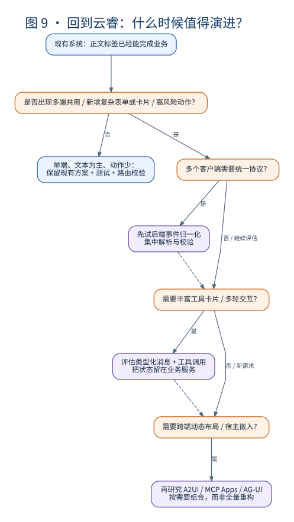

如果要给面临类似抉择的团队一点建议，我会看这几个信号：

1. **单端还是多端**：如果要同时支持 Web、App 和小程序，趁早把解析逻辑抽到后端或统一 SDK，否则各写一套正则你会疯。
2. **交互有多复杂**：只是几个简单的跳转和下载链接？那用文本标签或 Markdown 扩展就够了。要是搞出复杂表单、多步审批、购物车，赶紧上 Tool Calling 和结构化消息。
3. **有没有资金或安全风险**：涉及权限、钱、核心数据的动作，千万别信模型吐出来的任何前端参数，后端必须重新鉴权、幂等和审计。
4. **是不是真需要动态组装 UI**：如果页面就一张固定卡片，写个受控组件完事，没必要为了赶时髦硬上 A2UI 或 MCP Apps。
5. **历史包袱怎么算**：老会话怎么回放？迁移成本划不划算？这些都得算进账里。

真要回云睿去改造，我不会一上来就砸掉那 841 行代码。更务实的路径是：

- **第一步**：死守现有边界，把核心解析抽成可测模块，补齐流式分片、围栏和历史会话的回归测试，把前端路由白名单和后端鉴权卡死。
- **第二步**：新加的交互坚决不上标签了，统一走标准的结构化工具输出。
- **第三步**：等业务体量和多端需求真正爆发时，再平滑演进到后端事件归一化、AI SDK 或 A2UI 体系。

---

## 结语

文章开头那个小荷的标签，把我带回了当时的云睿。

刚开始做 AI 交互时，满脑子想的都是：“怎么让模型吐出一个漂亮的按钮？”
后来被流式分片和残缺 JSON 折腾得焦头烂额时，只想问：“怎么让这破按钮正确显示？”
再后来看了各种新架构后才明白，核心问题根本不在按钮本身，而在分工：

> **模型只管负责提供意图；协议负责干净、稳定地传递意图；前端负责把受控的数据渲染成好用的界面；而业务系统，则负责守住安全和状态的底线。**

当时那 841 行代码没有白写。它帮我们把产品送到了用户面前，也用实打实的痛苦，让我们看清了 AI 工程里那些华丽外表底下的真实复杂度。

---

## 参考资料与代码范围

**主流方案官方资料（检索日期：2026-11-15）**

1. [Google Developers Blog：A2UI 1.0（2026-11-11）](https://developers.googleblog.com/a2ui-10-build-delightful-fast-reliable-agentic-experiences/)
2. [MCP Apps：Overview](https://apps.extensions.modelcontextprotocol.io/)
3. [Google Developers Blog：A2UI + MCP Apps（2026-06-17）](https://developers.googleblog.com/en/a2ui-and-mcp-apps/)
4. [Ant Design X：@ant-design/x-card](https://x.ant.design/x-cards/introduce/)
5. [AI SDK UI：Chatbot](https://ai-sdk.dev/docs/ai-sdk-ui/chatbot)
6. [AI SDK UI：Chatbot Tool Usage](https://ai-sdk.dev/docs/ai-sdk-ui/chatbot-tool-usage)
7. [AG-UI：Events](https://github.com/ag-ui-protocol/ag-ui/blob/main/docs/concepts/events.mdx)
8. [A2UI 官方入口](https://a2ui.org/)